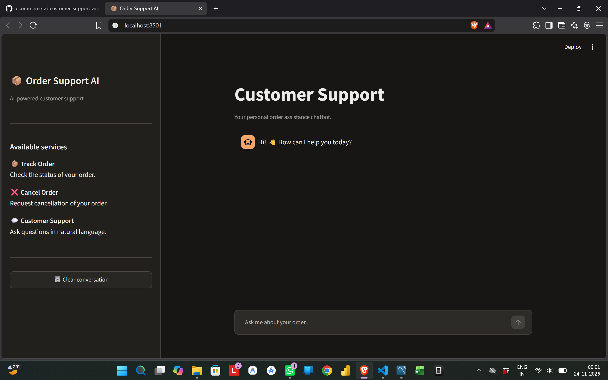
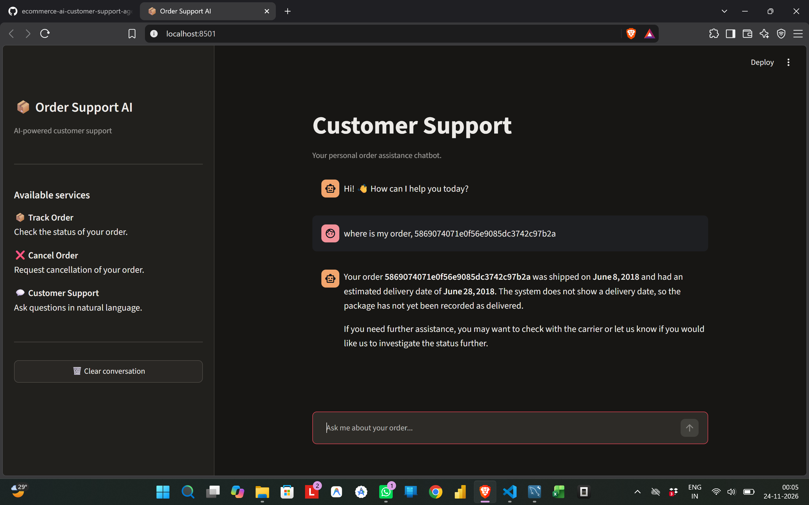
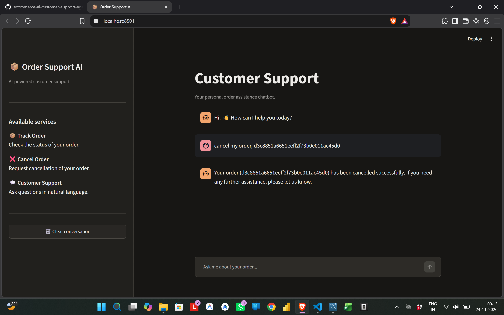
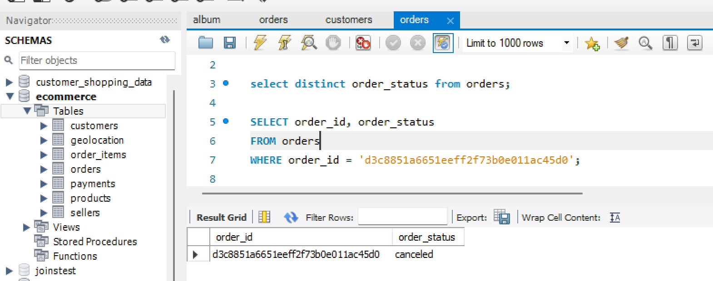

# 🤖 E-commerce AI Customer Support Agent

An AI-powered customer support agent that handles order-related queries through natural language. Built using **LangChain, Groq, Python, MySQL, and Streamlit**, the agent can intelligently select and execute tools to retrieve order information and process cancellation requests.

## 🔄 Project Update

This project was initially developed and tested using **MySQL** as its backend database. To make the deployed application accessible to everyone without requiring a separately hosted database, I migrated it to **SQLite** for the live demo.

The migration preserves the core functionality of the AI agent, including order status lookup, order cancellation, and conversational follow-ups. Anyone can now interact with and test the application directly through the live demo.

## 🚀 Overview

Traditional customer support systems rely heavily on manual queries and predefined workflows. This project explores how AI agents can automate common e-commerce support tasks by combining LLM reasoning with real database operations.

Users can interact with the agent conversationally to check order information or request cancellations. Based on the user's intent, the AI selects an appropriate tool, executes it, retrieves database results, and generates a natural-language response.

## 📸 Screenshots

### Main Application
<p align="center">
  
</p>

### Order Status Lookup
<p align="center">
  
</p>

### Order Cancellation
<p align="center">
  
</p>

### manual check
<p align="center">
  
</p>

## ✨ Features

- 💬 Natural-language customer interaction
- 📦 Order status lookup
- ❌ Order cancellation functionality
- 🧠 LLM-powered tool selection
- 🔗 LangChain tool integration
- 🗄️ MySQL database integration
- ⚡ Groq inference for fast responses
- 🖥️ Streamlit chat interface
- 🛠️ Backend tool execution with Python

## 🧰 Tech Stack

| Technology | Purpose |
|---|---|
| Python | Core application logic |
| LangChain | AI agent and tool integration |
| Groq API | LLM inference |
| OpenAI GPT-OSS-20B via Groq | Language model |
| MySQL | Order database |
| Streamlit | Interactive chatbot UI |
| python-dotenv | Environment configuration |

## ⚙️ How It Works

1. The customer submits a request through the Streamlit interface.
2. The LLM analyzes the request and identifies the required action.
3. The agent selects an appropriate tool.
4. The tool executes the corresponding Python function.
5. The database service interacts with MySQL.
6. The database result is passed to the LLM.
7. The LLM generates a customer-friendly response.

## 🔧 Available Tools

### `get_order_status(order_id)`

Retrieves order information from the database, including:

- Order ID
- Purchase timestamp
- Estimated delivery date
- Actual delivery date
- Order status

### `cancel_order(order_id)`

Checks the order status and processes cancellation when allowed by the current application logic.

The cancellation logic handles cases such as orders already delivered or already cancelled.

## 📂 Project Structure

```text
├── app.py
├── agent.py
├── db_service.py
├── .env
├── .env.example
├── .gitignore
└── requirements.txt
```

## 🛠️ Installation & Setup

### 1. Clone the repository

```bash
git clone https://github.com/YOUR_USERNAME/ecommerce-ai-customer-support-agent.git

cd ecommerce-ai-customer-support-agent
```

### 2. Create a virtual environment

```bash
python -m venv .venv
```

Activate it:

**Windows**

```bash
.venv\Scripts\activate
```

**Linux/macOS**

```bash
source .venv/bin/activate
```

### 3. Install dependencies

```bash
pip install -r requirements.txt
```

### 4. Configure environment variables

Create a `.env` file in the project root:

```env
GROQ_API_KEY=your_groq_api_key

DB_HOST=localhost
DB_USER=root
DB_PASSWORD=your_password
DB_NAME=ecommerce
```

### 5. Configure MySQL

Create the database and import/configure your e-commerce dataset with the appropriate `orders` table and required columns.

Ensure the database configuration in `db_service.py` matches your local setup.

### 6. Run the application

```bash
streamlit run app.py
```

The application will open in your browser.

## 💡 Example Queries

```text
Where is my order 123456?

Can you check the status of my order?

I want to cancel order 123456.

Can I cancel my order?
```

## 🎯 Project Goals

This project demonstrates practical implementation of:

- LLM-powered agents
- Tool calling
- AI-to-database interaction
- Backend function execution
- Natural-language interfaces
- AI application development

## 🔮 Future Improvements

- Conversation memory
- Cancellation confirmation workflow
- Customer ID-based order lookup
- Shipment tracking API integration
- Structured order status explanations
- Improved UI with order cards and tool execution indicators
- Authentication and customer-specific access control
- Deployment to cloud infrastructure

## ⚠️ Disclaimer

This project is a learning and portfolio project. Database operations are performed on a configured sample database and should not be used for real customer orders without appropriate security, authentication, authorization, and transaction safeguards.

---

Built with curiosity and a passion for AI-powered applications 🚀
